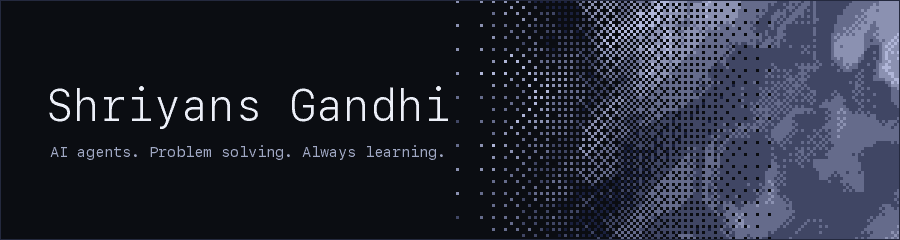
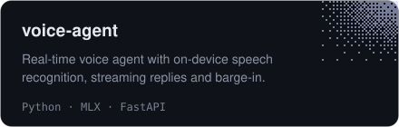
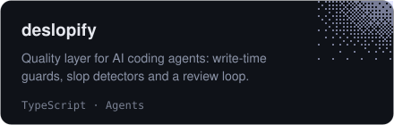
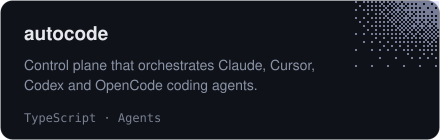
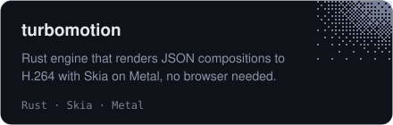

  
  

I like hard, messy problems and building until they're solved. Most of my work is on **AI agents**: systems that plan, use tools and finish what they start. Alongside that I work on real-time speech, GPU rendering and parametric CAD, and I learn whatever a problem requires.

## Selected work

<table>
  <tr>
    <td width="50%"></td>
    <td width="50%"></td>
  </tr>
  <tr>
    <td width="50%"></td>
    <td width="50%"></td>
  </tr>
</table>

## Toolbox

Go · Rust · Python · TypeScript · Swift · React · PostgreSQL · Supabase · Docker · AWS · GCP

## Get in touch

Have a hard problem or an agent idea? [Email me](mailto:shriyans.gandhi@gmail.com) or see my [portfolio](https://shri30yans.github.io/).
